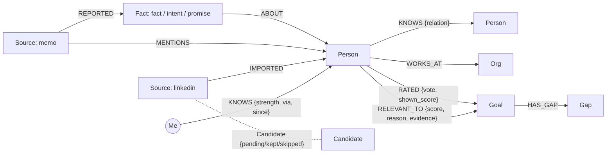

# Connections

Your network already knows who can help you. Connections finds them.

A personal CRM where AI agents walk your relationship graph, built on **FalkorDB** for Graph Hacks (WeMakeDevs x FalkorDB, Oct 2026).

**Live:** https://know-your-connection-1.onrender.com (free tier: the first load can take a minute while the server wakes up)

You have hundreds of LinkedIn connections, but when you need something, like a remote job, you can't tell who can actually help. And the right person is often one friend away, in a network you can't see. Connections fixes both without scraping anyone:

1. **Import.** Upload the export LinkedIn gives you of your own connections (the zip or `Connections.csv`). Every row becomes a card, and nobody is added until you swipe: right to keep, up for your inner circle, left to skip.
2. **Friends.** Add friends by handle. Once they accept, their agent can search their network for you, with no request or approval each time.
3. **Goals.** Write a goal ("I want a remote job"). The planner works out which kinds of people would open that door, and your whole network re-ranks around it: every person gets a score and a one-line reason. When the goal depends on a company fact (does this company hire remotely?), the candidates' companies are checked on the web first, so a reason rests on evidence instead of the model's memory. Switch to **Map** for a force graph of the people who fit: drag, zoom, and hover anyone to light up the path back to you.
4. **Ask your network.** One tap on a goal runs your friends' agents straight away. Each searches its owner's FalkorDB graph, scores the candidates from their public profile only, and lists who fits and through whom. Your own matches stay on top, friends' matches below, and the results are saved with the goal. Friends of friends are a Pro option.
5. **It learns from you.** Mark any suggestion **Good fit** or **Wrong**. Wrong ones disappear and stay out of later rankings, and both kinds are shown to the model as examples next time. Each goal shows how accurate its strong suggestions were on your ratings. A private **About you** line in the profile menu tells the ranking your role, skills, location and what you want.
6. **Status lines.** Anyone can write one line about themselves ("Hiring remote SDE interns") and link their LinkedIn. Wherever they appear in their friends' networks (or their friends' friends'), Find and the agents see it, so the people who are actually hiring rise to the top.
7. **Find.** Search a role like "SDE", or something you noted like "hiring intern", across your graph and your friends' graphs. Matches come back by degree: people you know first, then people your friends know, with the path ("Through Bhavya"). 3rd degree (your friends' friends) is a Pro feature because it walks many more graphs.
8. **Notes.** Open anyone and add a one-line note ("wants a cofounder"). Find searches it and the ranking reads it, so "hiring intern" finds Priya even though her title says Investment Associate.

Rules enforced in code, not on a slide: your notes, memos, About you and ratings are only ever read for you; Find and friends' agents read a friend's graph only if that friend leaves "Friends can find my contacts" on, and only the profile a LinkedIn connection already shows (name, title, company, link) crosses over, never notes, memos or tie strength; any account can turn that off in one tap; relationships never decay and nobody gets a worth score; every suggestion has a reason, and every ranking has a receipt.

**Tracks:** Agent Memory and Coordination (agents persist memory per user and coordinate through a shared graph) and Agents That Act on Connected Data (multi-hop, explainable ranking with sources).

## How FalkorDB is used

FalkorDB is the only datastore. Everything is Cypher.

| What | How |
| --- | --- |
| Per-user isolation | Every account gets its own FalkorDB graph, `connections_user_<id>`. Request handlers only ever open the signed-in user's graph (`auth.graph_of`). Separate graphs are separate keys, so there is no query that can wander into someone else's network. |
| Cross-user protocol | One shared graph, `connections_shared`, holds accounts, friendships, requests, replies (count and strength only) and opt-in cards. |
| Multi-hop warm paths | Ranking walks `(:Me)-[:KNOWS]->(p)` and `(:Me)-[:KNOWS]->(via)-[:KNOWS]-(p)`, so someone you heard about in a memo shows up as "warm path via Kabir Singh (cofounder)". |
| Vector search | With a model configured, people get embeddings (Amazon Titan Text v2 on Bedrock, or OpenAI `text-embedding-3-small`) in a FalkorDB vector index (`CREATE VECTOR INDEX ... cosine`). Large networks are shortlisted with `db.idx.vector.queryNodes` per need before the model scores them. |
| Full-text | `db.idx.fulltext.createNodeIndex('Person', ...)` over name, company, position and headline. |
| Degree search | `search.py` runs one Cypher query per graph: `(:Me)-[:KNOWS]->(p)` filtered by role phrases for 1st degree, the same in each friend's graph plus `(:Me)-[:KNOWS]->(via)-[:KNOWS]-(p)` memo ties for 2nd, and friends-of-friends (from `FRIEND` edges in the shared graph) for 3rd. Results are de-duplicated by LinkedIn URL or name, and the lowest degree wins. "SDE" expands to title phrases (SDE II, software engineer, backend developer, member of technical staff); unknown roles are expanded by the model. |
| Status lines | Each account can write one line about itself ("Hiring SDE interns at Confluent") and link its LinkedIn profile. The status attaches to that person wherever they sit in someone's network, matched by LinkedIn URL, so Find surfaces them for "hiring interns" and goal ranking treats it as first-hand evidence. Same reach as Find: friends and their friends, and off when search is off. |
| Web checks | When a goal turns on a company fact ("remote job": remote work policy), the planner names it, the top candidates' companies are searched on the web in parallel, and the snippets go to the model as evidence it must cite. Results are cached per company in the shared graph as `(:WebCheck)` nodes for a week. A ranking that rests on a company fact without a web source is capped as unknown. Set `TAVILY_API_KEY` (or `BRAVE_API_KEY`). |
| Feedback | Good fit and Wrong on each suggestion are stored as `(:Person)-[:RATED {vote, shown_score, at}]->(:Goal)` edges (friends' people as votes on the goal). Wrong ones leave later rankings, and the next ranking sees both lists as examples, so it learns what you mean by "internship". |
| About you | One private line on `(:Me)` (role, skills, location, what you want). The planner and the scorer read it; no other account can. |
| Staged ranking | Shortlist from the graph and vector index, check the role fits, attach status lines and web facts, score with the model, then a second verify pass over the top 12 that drops anyone whose reason does not hold up. Graph signals the model weighs badly (close tie, notes you wrote, how many friends connect you, distance) nudge the score. |
| Accuracy | Each goal shows the share of strong suggestions you rated as right, measured on the scores you actually saw. |
| Receipts | Every `Person` and `Fact` hangs off a `Source` node (LinkedIn import, memo, or intro card). Ranking evidence must be a real `Fact` id or the person's profile, or it is dropped. Deleting a source removes what only it vouched for. |



The shared graph `connections_shared` holds `(:User)-[:FRIEND]-(:User)` with each account's status line and LinkedIn key, and `(:WebCheck)` nodes caching web results per company and question.

### LinkedIn import with swipe-to-confirm

- Accepts the `.zip` LinkedIn emails you or the `Connections.csv` inside it. The parser skips LinkedIn's notes preamble, handles header and date variants, strips emoji and credentials from names, and de-duplicates rows.
- Upload creates `(:Candidate)` nodes only. A swipe turns one into a `Person` plus a `KNOWS` edge and an `IMPORTED` receipt.
- A row that matches someone already in your graph (same LinkedIn URL, or same name as a memo person) is shown as a merge, and keeping it fills in their missing company and title instead of creating a duplicate.
- Undo reverses the last decision exactly, including merges.
- Re-importing a newer export only shows connections you haven't triaged yet.
- Cards that match an open goal are sorted to the front and show which words matched.

## Run it

**Docker (FalkorDB plus the app):**

```bash
cp .env.example .env        # add a Bedrock API key (or OpenAI key) for real extraction and ranking
docker compose up --build
```

Open http://localhost:8000. FalkorDB Browser runs on http://localhost:3000 if you want to look at the graphs during a demo.

**Without Docker:**

```bash
# FalkorDB: docker run -p 6379:6379 -p 3000:3000 falkordb/falkordb
# or, with no Docker at all: pip install falkordblite (bundles a FalkorDB server)

cd backend
python3.12 -m venv .venv && . .venv/bin/activate
pip install -r requirements-dev.txt
export AWS_BEARER_TOKEN_BEDROCK=...   # optional, see below
export AWS_REGION=us-east-1
uvicorn app.main:app --reload --port 8000

cd ../frontend
npm install
npm run dev                           # http://localhost:5173, proxies /api to :8000
```

Without a model key the app runs on offline keyword heuristics so every flow works, but extraction and ranking are much better with a model.

### Model: AWS Bedrock or OpenAI

The app uses whichever key it finds (or set `LLM_PROVIDER` to `mantle`, `bedrock`, `openai` or `offline`).

- **Amazon Bedrock Mantle (what the live demo runs).** Create an API key in the Bedrock console under **API keys** and set `AWS_BEARER_TOKEN_BEDROCK` plus `AWS_REGION` (the region you made the key in). With no `BEDROCK_MODEL_ID`, the app calls OpenAI-style models through Mantle's OpenAI-compatible API, using `MANTLE_MODEL_ID` or the best model the key can list. The demo runs `openai.gpt-oss-120b`.
- **AWS Bedrock Converse.** Set `BEDROCK_MODEL_ID` as well (for example `global.anthropic.claude-haiku-5-5`) to use any Bedrock model that supports tool use. Structured output comes from forcing a single tool call whose input schema is the expected result. Embeddings use `amazon.titan-embed-text-v2:0` (set `BEDROCK_EMBED_MODEL_ID` empty to turn them off). Bedrock has no speech-to-text, so voice memos use the browser's built-in dictation. If AWS refuses the main model (for example Anthropic's one-time use-case form isn't filled in, or the AWS Marketplace subscription can't be created, which is common on Indian AISPL accounts), the app switches to Amazon Nova 2 Lite (`global.amazon.nova-2-lite-v1:0`) automatically and `/api/health/model` reports the switch. Override the list with `BEDROCK_FALLBACK_MODEL_IDS`, or set it to `none`.
- **OpenAI.** Set `OPENAI_API_KEY`. Uses structured outputs, `text-embedding-3-small`, and server-side transcription for voice memos.

`GET /api/health/model` makes one real model call and reports the error code with a hint if the key, region or model ID is wrong. Voice memos need the key.

**Tests** (needs a FalkorDB on localhost:6379; uses its own graph prefix):

```bash
cd backend && pytest -q
```

## Deploy

The `Dockerfile` builds one container that serves the API and the web app. Any container host works (Render, Railway, Fly, a VM). Point it at FalkorDB Cloud or a FalkorDB container:

| Variable | Example |
| --- | --- |
| `FALKORDB_HOST` | `r-xxxx.instance-xxxx....cloud` (from the FalkorDB Cloud Connect dialog) |
| `FALKORDB_PORT` | `61155` |
| `FALKORDB_USERNAME` | `falkordb` |
| `FALKORDB_PASSWORD` | your instance password, any characters |
| `AWS_BEARER_TOKEN_BEDROCK` | your Bedrock API key |
| `AWS_REGION` | the region the key was created in, e.g. `us-east-1` |
| `MANTLE_MODEL_ID` | optional, e.g. `openai.gpt-oss-120b` |
| `BEDROCK_MODEL_ID` | optional; set it to use Bedrock Converse instead of Mantle |
| `TAVILY_API_KEY` | web checks for company facts (free tier is enough); `BRAVE_API_KEY` also works |
| `OPENAI_API_KEY` | instead of Bedrock: `sk-...` |
| `CONNECTIONS_PUBLIC_URL` | `https://connections.example.com` (used in opt-in links) |
| `PORT` | set by most hosts; defaults to 8000 |

Instead of the four `FALKORDB_*` fields you can set one `FALKORDB_URL` (`redis://falkordb:<password>@<host>:<port>`). Set the health check path to `/api/health`. If it fails, the server log names the FalkorDB host it tried (password hidden) and the reason: a `ConnectionError` means a wrong host or port, or the instance is stopped; an `AuthenticationError` means a wrong username or password.

## Demo script (about 2.5 minutes)

Before recording: open the live app once so it is awake, and make sure the two demo accounts are already friends.

1. **Import.** Upload your LinkedIn `Connections.csv` (or choose **Try it with sample connections**) and swipe a few. Nothing is added before the swipe.
2. **Friends.** Show the friends list and adding a friend by handle.
3. **Goal.** With a line in **About you** (profile menu), add "Join an early-stage startup (pre-seed to Series A) as a founding engineer on backend or platform". Show the kinds of people it plans for (founders and CTOs, startup recruiters, seed investors), then the ranked list: each person has a score and a one-line reason. Open one person's LinkedIn.
4. **Feedback.** Mark a strong match **Good fit** and a weak one **Wrong**. The wrong one disappears and the accuracy line updates. The next **Re-rank** learns from both.
5. **Ask your network.** Tap it: your friends' agents search their graphs and list the people who fit, with the path to each.
6. **Map.** Switch to Map, drag a node, and hover a friend's contact to light up the path through your friend.
7. **Status and Find.** Show **Your status** on Friends ("Hiring our first backend engineer"), then search "founder" or "hiring" in Find: results come back 1st degree, then 2nd degree, with statuses and your notes highlighted.
8. Optional: open FalkorDB Browser and show that each account is its own graph.

## What we say about privacy, and what we don't

Per-user graphs isolate each network by construction. Find and friends' agents are the deliberate exception: friends who leave the search setting on let their friends (and, on Pro, their friends' friends) see the LinkedIn-level profile of their contacts, never notes, memos, About you or ratings. Status lines are the one thing an account publishes on purpose, and they reach the same people. That is the claim. The app does not encrypt data at rest, does not protect anything from whoever operates the server, and the hackathon login is a bearer token without passwords. Text sent to the model for scoring follows that provider's API terms.

## Layout

```
backend/app/
  main.py        HTTP routes
  auth.py        bearer-token viewer, the only way to a user graph
  db.py          FalkorDB connection, per-user and shared graphs, indexes
  linkedin.py    LinkedIn export parser
  imports.py     candidates, swipe decisions, undo, bulk, deck ordering
  capture.py     memo to people, facts, intents, promises, ties (API only; the app uses per-person notes)
  goals.py       goal planning, staged ranking (shortlist, role check, web facts, score, verify), receipts
  search.py      Find: role search by degree across your graph and friends' graphs, and friends' agents
  smart.py       about you, feedback edges, graph signals, accuracy
  web.py         company checks on the web (Tavily, Brave or DuckDuckGo), cached in the shared graph
  exchange.py    PostRequest, Answer, AskForIntro, Approve, OptIn, Reveal
  network.py     people, sources, deletion with provenance, embeddings
  llm.py         AWS Bedrock (forced tool use) or OpenAI (structured outputs), plus offline heuristics
frontend/src/    React app (swipe import, goals with list and d3-force map, ask your network, feedback, find,
                 friends and status, person cards with notes, about you in the profile menu)
samples/         a fictional Connections.csv for demos and tests
```

## Roadmap

Live-linked cards, an in-person QR handshake, an opt-in card directory, importing LinkedIn messages as context, web checks on every fact (not only company questions), a stronger scoring model, and encryption at rest.
