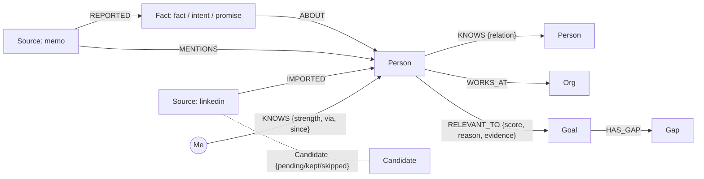

# Connections

A personal CRM where AI agents walk your relationship graph, built on **FalkorDB** for Graph Hacks (WeMakeDevs x FalkorDB, Oct 2026).

You meet thirty new people a month and remember a third of them. LinkedIn shows connections with no context, and the friend across the table who knows exactly who you need never mentions it. Connections fixes both without scraping anyone:

1. **Import.** Upload the export LinkedIn gives you of your own connections. Every row becomes a card. Nobody is added until you swipe: right to keep, up for your inner circle, left to skip.
2. **Capture.** A 30 second memo after you meet someone becomes people, facts, intents, promises and ties in your graph, each pointing back at the memo that produced it.
3. **Aim.** Set a goal ("summer 2027 VC internship") and your network re-ranks around it, with a reason and receipts per person. Change the goal, the ranking rebuilds. Close it, the ranking disappears. Open goals also reorder the import deck so the connections that fit come first.
4. **Find the gap.** When a goal needs a kind of person you have no path to, the app says so: "No warm path to climate-tech VC."
5. **Ask the network.** Your agent sends a redacted request to friends. Each friend's agent searches only its owner's graph and answers with a count and a strength, no names. The friend picks someone privately, that person writes their own card, and only then do you see them, with a three-way intro drafted.

Rules enforced in code, not on a slide: an agent never reads another user's graph; every step that moves someone toward a new person needs a human click; the only thing about a third person that ever crosses accounts is a card that person wrote; relationships never decay and nobody gets a worth score; every suggestion has a receipt.

**Tracks:** Agent Memory and Coordination (agents persist memory per user and coordinate through a shared graph) and Agents That Act on Connected Data (multi-hop, explainable ranking with sources).

## How FalkorDB is used

FalkorDB is the only datastore. Everything is Cypher.

| What | How |
| --- | --- |
| Per-user isolation | Every account gets its own FalkorDB graph, `connections_user_<id>`. Request handlers only ever open the signed-in user's graph (`auth.graph_of`). Separate graphs are separate keys, so there is no query that can wander into someone else's network. |
| Cross-user protocol | One shared graph, `connections_shared`, holds accounts, friendships, requests, replies (count and strength only) and opt-in cards. |
| Multi-hop warm paths | Ranking walks `(:Me)-[:KNOWS]->(p)` and `(:Me)-[:KNOWS]->(via)-[:KNOWS]-(p)`, so someone you heard about in a memo shows up as "warm path via Kabir Singh (cofounder)". |
| Vector search | With a model configured, people get embeddings (Amazon Titan Text v2 on Bedrock, or OpenAI `text-embedding-3-small`) in a FalkorDB vector index (`CREATE VECTOR INDEX ... cosine`). Large networks are shortlisted with `db.idx.vector.queryNodes` per need before the model scores them. |
| Full-text | `db.idx.fulltext.createNodeIndex('Person', ...)` over name, company, position and headline. |
| Receipts | Every `Person` and `Fact` hangs off a `Source` node (LinkedIn import, memo, or intro card). Ranking evidence must be a real `Fact` id or the person's profile, or it is dropped. Deleting a source removes what only it vouched for. |



### LinkedIn import with swipe-to-confirm

- Accepts the `.zip` LinkedIn emails you or the `Connections.csv` inside it. The parser skips LinkedIn's notes preamble, handles header and date variants, strips emoji and credentials from names, and de-duplicates rows.
- Upload creates `(:Candidate)` nodes only. A swipe turns one into a `Person` plus a `KNOWS` edge and an `IMPORTED` receipt.
- A row that matches someone already in your graph (same LinkedIn URL, or same name as a memo person) is shown as a merge, and keeping it fills in their missing company and title instead of creating a duplicate.
- Undo reverses the last decision exactly, including merges.
- Re-importing a newer export only shows connections you haven't triaged yet.
- Cards that match an open goal are sorted to the front and show which words matched.

## Run it

**Docker (FalkorDB plus the app):**

```bash
cp .env.example .env        # add a Bedrock API key (or OpenAI key) for real extraction and ranking
docker compose up --build
```

Open http://localhost:8000. FalkorDB Browser runs on http://localhost:3000 if you want to look at the graphs during a demo.

**Without Docker:**

```bash
# FalkorDB: docker run -p 6379:6379 -p 3000:3000 falkordb/falkordb
# or, with no Docker at all: pip install falkordblite (bundles a FalkorDB server)

cd backend
python3.12 -m venv .venv && . .venv/bin/activate
pip install -r requirements-dev.txt
export AWS_BEARER_TOKEN_BEDROCK=...   # optional, see below
export AWS_REGION=us-east-1
uvicorn app.main:app --reload --port 8000

cd ../frontend
npm install
npm run dev                           # http://localhost:5173, proxies /api to :8000
```

Without a model key the app runs on offline keyword heuristics so every flow works, but extraction and ranking are much better with a model.

### Model: AWS Bedrock or OpenAI

The app uses whichever key it finds (or set `LLM_PROVIDER` to `bedrock`, `openai` or `offline`).

- **AWS Bedrock (default if a Bedrock key is set).** Create an API key in the Bedrock console under **API keys** and set `AWS_BEARER_TOKEN_BEDROCK` plus `AWS_REGION` (the region you made the key in). The default model is Claude Haiku 5.5 through the global inference profile `global.anthropic.claude-haiku-5-5`; change it with `BEDROCK_MODEL_ID` to any Bedrock model that supports tool use. Structured output comes from forcing a single tool call whose input schema is the expected result. Embeddings use `amazon.titan-embed-text-v2:0` (set `BEDROCK_EMBED_MODEL_ID` empty to turn them off). Bedrock has no speech-to-text, so voice memos use the browser's built-in dictation. If AWS refuses the main model (for example Anthropic's one-time use-case form isn't filled in, or the AWS Marketplace subscription can't be created, which is common on Indian AISPL accounts), the app switches to Amazon Nova 2 Lite (`global.amazon.nova-2-lite-v1:0`) automatically and `/api/health/model` reports the switch. Override the list with `BEDROCK_FALLBACK_MODEL_IDS`, or set it to `none`.
- **OpenAI.** Set `OPENAI_API_KEY`. Uses structured outputs, `text-embedding-3-small`, and server-side transcription for voice memos.

`GET /api/health/model` makes one real model call and reports the error code with a hint if the key, region or model ID is wrong. Voice memos need the key.

**Tests** (needs a FalkorDB on localhost:6379; uses its own graph prefix):

```bash
cd backend && pytest -q
```

## Deploy

The `Dockerfile` builds one container that serves the API and the web app. Any container host works (Render, Railway, Fly, a VM). Point it at FalkorDB Cloud or a FalkorDB container:

| Variable | Example |
| --- | --- |
| `FALKORDB_HOST` | `r-xxxx.instance-xxxx....cloud` (from the FalkorDB Cloud Connect dialog) |
| `FALKORDB_PORT` | `61155` |
| `FALKORDB_USERNAME` | `falkordb` |
| `FALKORDB_PASSWORD` | your instance password, any characters |
| `AWS_BEARER_TOKEN_BEDROCK` | your Bedrock API key |
| `AWS_REGION` | the region the key was created in, e.g. `us-east-1` |
| `BEDROCK_MODEL_ID` | optional, default `global.anthropic.claude-haiku-5-5` |
| `OPENAI_API_KEY` | instead of Bedrock: `sk-...` |
| `CONNECTIONS_PUBLIC_URL` | `https://connections.example.com` (used in opt-in links) |
| `PORT` | set by most hosts; defaults to 8000 |

Instead of the four `FALKORDB_*` fields you can set one `FALKORDB_URL` (`redis://falkordb:<password>@<host>:<port>`). Set the health check path to `/api/health`. If it fails, the server log names the FalkorDB host it tried (password hidden) and the reason: a `ConnectionError` means a wrong host or port, or the instance is stopped; an `AuthenticationError` means a wrong username or password.

## Demo script (about 3 minutes)

1. Create an account. On Import, choose **Try it with sample connections** (fictional people) or upload a real export.
2. Swipe a few: right, up, left. Press Z to undo one. Point out that nothing was added before the swipe.
3. Goals: add "Summer 2027 VC internship". Show the gap if nothing fits yet, then go back to Import: the investors now lead the deck with the matching words underlined. Keep a few and press **Re-rank**. Each person has a reason and a receipt pointing at the LinkedIn export.
4. Capture: paste "Had coffee with Kabir Singh from Tessellate Labs. Kabir said his cofounder Leela Varma is a climate investor at Pinecone Grove. I'll send Kabir my resume by Friday." Leela appears through a dashed ring (reached via Kabir), and the promise shows up under Capture.
5. Open the account menu, add a second account ("Bhavya"), add each other as friends by handle, and have Bhavya capture a memo about a climate VC.
6. As the first account, open the gap on a goal and choose **Ask your network**. The reply shows a count only. Ask for an intro, switch to Bhavya, pick the contact and copy the opt-in link. Open it, write the card, share. Back as the first account, the card and intro draft appear.
7. Optional: open FalkorDB Browser and show that each account is its own graph.

## What we say about privacy, and what we don't

Per-user graphs isolate each network by construction, and the Exchange never writes a third person's details to the shared graph until they write their own card. That is the claim. The app does not encrypt data at rest, does not protect anything from whoever operates the server, and the hackathon login is a bearer token without passwords. Data sent to OpenAI for extraction and ranking follows OpenAI's API terms.

## Layout

```
backend/app/
  main.py        HTTP routes
  auth.py        bearer-token viewer, the only way to a user graph
  db.py          FalkorDB connection, per-user and shared graphs, indexes
  linkedin.py    LinkedIn export parser
  imports.py     candidates, swipe decisions, undo, bulk, deck ordering
  capture.py     memo to people, facts, intents, promises, ties
  goals.py       goal planning, two-hop ranking with receipts, gap finding
  exchange.py    PostRequest, Answer, AskForIntro, Approve, OptIn, Reveal
  network.py     people, sources, deletion with provenance, embeddings
  llm.py         AWS Bedrock (forced tool use) or OpenAI (structured outputs), plus offline heuristics
frontend/src/    React app (swipe deck, people, goals, capture, ask, opt-in page)
samples/         a fictional Connections.csv for demos and tests
```

## Roadmap

Live-linked cards, friend-of-friend relays, an in-person QR handshake, an opt-in card directory, importing LinkedIn messages as context, public-web enrichment with a URL on every fact, and encryption at rest.
